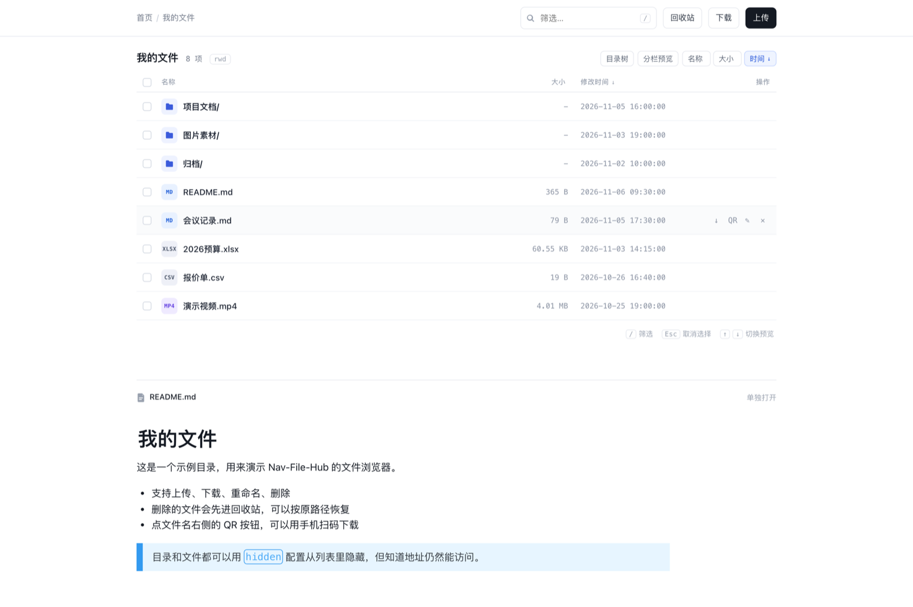
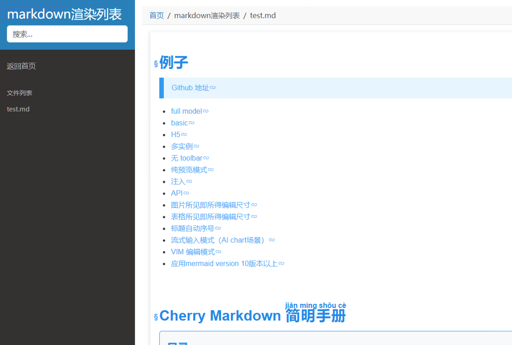

# Nav-File-Hub

一个轻量级、跨平台的个人文件浏览器和导航工具。支持站点导航、文件管理、二维码下载、密码保护路由，并集成系统托盘运行。

## ✨ 特性

- **MD渲染器**: 布局采用`readthedocs`样式,使用开源的`cherry-markdown`渲染
- **文件浏览器**：浏览本地目录，支持文件上传、下载、删除、重命名。
- **回收站**：删除先进回收站，记录原路径，可一键恢复；支持保留期自动清理。
- **按目录隐藏**：指定目录只在列表里消失，知道地址仍可访问（隐藏不是权限）。
- **通配符支持**：使用 `*` 或 `*.ext` 过滤文件类型（如 `*.docx`）。
- **二维码下载**：为文件生成二维码，方便移动设备下载。
- **密码保护**：为特定路由设置密码访问。
- **系统托盘**：后台运行，点击托盘图标打开浏览器。
- **嵌入资源**：静态文件、模板和图标全部嵌入，无需外部依赖。
- **实时配置**：YAML 配置自动重载，支持在线编辑。
- **跨平台**：支持 Windows、Linux、macOS。

## 🖼️ 预览

### 主页 - 随身导航


### 文件浏览器


### MD渲染器



## 🚀 安装

### 下载预构建版本
从 [Releases](https://github.com/Jonnyan404/nav-file-hub/releases) 页面下载对应平台的二进制：

| 平台 | 文件名 |
| --- | --- |
| Linux x86_64 | `nav-file-hub-linux-amd64` |
| Linux ARM64 | `nav-file-hub-linux-arm64` |
| Linux ARMv7（树莓派等 32 位 ARM） | `nav-file-hub-linux-armv7` |
| Windows x86_64 | `nav-file-hub-windows-amd64.exe` |
| Windows ARM64 | `nav-file-hub-windows-arm64.exe` |
| macOS Intel（DMG 安装包） | `nav-file-hub-darwin-amd64.dmg` |
| macOS Apple Silicon（DMG 安装包） | `nav-file-hub-darwin-arm64.dmg` |
| macOS Intel（裸二进制） | `nav-file-hub-darwin-amd64` |
| macOS Apple Silicon（裸二进制） | `nav-file-hub-darwin-arm64` |

Linux / macOS 下载后 `chmod +x` 即可运行（Windows 直接双击）。每个 Release 附带 `checksums.txt`，可用 `sha256sum -c` 校验。

**macOS 用户**：推荐下载 `.dmg`，打开后把 `NavFileHub` 拖进「应用程序」即可，启动后驻留在菜单栏。

首次打开会被 Gatekeeper 拦截（提示"无法验证开发者"），因为安装包未做代码签名。任选一种方式放行：

- 在「系统设置 → 隐私与安全性」里点「仍要打开」；或
- 终端执行 `xattr -dr com.apple.quarantine /Applications/NavFileHub.app`

macOS 版的配置和日志分别存放在 `~/Library/Application Support/NavFileHub/` 和 `~/Library/Logs/NavFileHub/`。

### 使用 Docker
1. 拉取镜像：
   ```bash
   docker pull jonnyan404/nav-file-hub:latest
   # 二选一
   docker pull ghcr.io/jonnyan404/nav-file-hub:latest
   ```

2. 运行容器（将 `/host/path/to/files` 替换为你的本地文件目录）：
   ```bash
   docker run -d --name nav-file-hub -p 10000:10000 \
     -v /host/path/to/files:/data \
     jonnyan404/nav-file-hub:latest
   # 二选一
   docker run -d --name nav-file-hub -p 10000:10000 \
     -v /host/path/to/files:/data \
     ghcr.io/jonnyan404/nav-file-hub:latest
   ```

3. 访问 `http://localhost:10000` 使用应用。


## 📖 使用

1. 运行 `nav-file-hub.exe`（或 nav-file-hub）。
2. 应用将在系统托盘中显示图标。
3. 点击托盘菜单中的“打开随身导航”以在浏览器中访问（默认 `http://localhost:10000`）。
4. 使用浏览器管理文件、配置站点等。

### 主要路由
- `/`：主页，显示所有站点。
- `/app/`：文件浏览器（示例路由）。
- `/doc/`：仅显示 `.docx` 文件（示例路由）。
- `/app/trash`：回收站（把 `app` 换成你的 `router` 名）。
- `/config/`：在线编辑配置文件。

## ⚙️ 配置

配置文件为 `config.yaml`，首次运行时自动生成默认配置。支持实时重载。

### 示例配置
```yaml
# 定义服务器监听的端口
port: 10000

# 回收站保留天数：超过就自动清理，0 或不写表示永久保留
trash_retention_days: 30

# 定义需要密码保护的路由
protected_routes:
  - router: "app"
    pwd: "123"
  - router: "internal"
    pwd: "admin"
    pwds: # 同一路由的额外密码，任意一个都能进
      - "guest-2026"
      - "another-one"
  - router: "/"
    pwd: ""
  - router: "config" # 配置文件在线加密访问
    pwd: "admin"

sites:
  - name: docker文件列表
    url: '/data/*' # Docker容器文件列表示例
    router: "docker"
    rule: "rwd" #read, write, delete(此参数不设置则默认只读;设为空没有任何权限,仅展示列表名称.)
    hidden: # 只从列表里隐藏，直接访问 /docker/tmp 仍然可以进
      - tmp
      - "*.bak"

  - name: 配置文件在线编辑
    url: config.yaml
    router: "config"

  - name: markdown渲染列表
    url: '/data/markdown/*.md'
    router: "md"

  - name: GitHub主页
    url: https://github.com/jonnyan404
    pin: true
    # pin 设为 true, 则该站点会被置顶显示

  - name: Dockerhub主页
    url: https://hub.docker.com/r/jonnyan404
    # router 为空, 会在所有页面显示

  - name: Dockerhub主页
    url: https://hub.docker.com/r/jonnyan404
    hide: true
    # hide 设为 true, 则不会在任何页面显示

  - name: 内部工具
    url: http://192.168.1.100/tools
    router: "internal" # 这个站点将只在 /internal 路由下显示

  - name: windows文件列表功能
    url: 'D:\test\*' # window路径必须加单引号,否则会报错
    router: "windows"
    rule: "rwd" #read, write, delete(此参数不设置则默认只读;设为空没有任何权限,仅展示列表名称.)

  - name: 仅展示docx文件
    url: 'D:\test\*.docx' # window路径必须加单引号,否则会报错
    router: "doc"
    rule: "rwd" #read, write, delete(注释此参数则默认只读;设为空没有任何权限,仅展示列表名称.)
```

### 配置说明
- **port**：服务器端口。
- **trash_retention_days**：回收站保留天数，超过自动清理；不写或 `0` 表示永久保留。
- **protected_routes**：密码保护路由，`pwd` 为空表示无需密码。
  - `pwd`：主密码。
  - `pwds`：同一路由的额外密码，任意一个都能进。适合「自己的密码 + 给朋友的临时密码」，
    临时密码删掉即刻失效（Cookie 是按「路由+密码」算的，删掉对应条目旧 Cookie 自动作废）。
- **sites**：
  - `url`：本地路径，支持通配符（`*` 或 `*.ext`）。
  - `router`：路由名称。
  - `rule`：权限字符串（r=读, w=写, d=删）。
  - `pin`：置顶显示。
  - `hide`：隐藏站点。
  - `hidden`：站点内要隐藏的目录/文件，详见下方「按目录隐藏」一节。

### 同一目录，多个路由不同权限

想让同一个目录既能公开只读、又能自己写入，把站点条目复制一份、换 router 和 rule 即可：

```yaml
sites:
  - name: 共享只读
    url: '/data/*'
    router: "share"
    rule: "r"      # 只能看

  - name: 我的写入入口
    url: '/data/*'
    router: "mine"
    rule: "rwd"    # 可上传/重命名/删除
```

`/share/` 和 `/mine/` 是同一个物理目录，权限各按自己那条 rule 生效。几点说明：

- 回收站是目录级的（站点根下只有一个 `.deleted`），两个路由共用；但只有带 `d` 权限的路由能看到「回收站」入口。
- `hidden` / `.navignore` 按站点各自生效，所以两条路由可以显示不同的条目。
- 配置里如果两条路由指向同一目录、rule 又完全相同，启动时会给出「可能是复制粘贴忘了改」的提醒。

## 🗑️ 回收站

有删除权限（`rule` 含 `d`）的站点，文件列表右上角会出现「回收站」入口，也可以直接访问 `/router/trash`。

删除文件时并不会真的删掉，而是移进站点根目录下的 `.deleted/`：

```
.deleted/
  └── 20261030-133842.417368000-99c36548/
      ├── meta.json   # 原路径、删除时间、大小
      └── data        # 文件或目录本体
```

在回收站页面可以：

- **恢复**：按 `meta.json` 里记录的原路径放回原处，上级目录不存在会自动创建；原位置已被占用时自动改名，不会覆盖现有文件。
- **彻底删除**：单条永久删除。
- **清空回收站**：一次性清空。
- **保留期**：配置了 `trash_retention_days` 时，启动会清理一次，之后每天清理一次过期条目。

几点说明：

- `.deleted` 目录**不对外提供访问**（`/router/.deleted/` 直接返回 403），只能通过回收站页面操作。
- 回收站条目仍占用磁盘空间，定期清空或设置保留期。
- 旧版本留下的扁平条目（没有 `meta.json`）会在列表里标「旧格式」，恢复时放回站点根目录。

## 🙈 按目录隐藏

想让某些目录只在网页列表里消失、但知道地址仍能访问（例如 `/dir/tmp`），有两种写法。

**方式一：站点配置 `hidden`**

```yaml
sites:
  - name: dir
    url: '/data/*'
    router: "dir"
    rule: "rwd"
    hidden:
      - tmp          # 隐藏任意层级的 tmp
      - docs/draft.md # 只隐藏 docs/draft.md
      - "*.bak"      # 通配符
```

**方式二：目录里放 `.navignore`**（gitignore 风格，对该目录及子目录生效）

```
# /data/.navignore
tmp
*.log
docs/draft.md
```

匹配规则：

| 写法 | 含义 |
| --- | --- |
| `tmp` | 任意层级的 `tmp`（文件名匹配） |
| `docs/draft.md` | 相对路径整段匹配，不会误伤 `x/docs/draft.md` |
| `/tmp` | 锚定在配置所在目录（`.navignore` 里同理） |
| `*.bak` | glob，`*` 不跨目录 |
| `# 注释` | 忽略 |

隐藏规则的生效范围：文件列表、目录树、Markdown 站点文件列表、搜索。**路由层不做任何拦截**——隐藏只是「不上台面」，不是权限控制。真要挡人，请给这个 router 配 `protected_routes` 密码，或者把目录移出站点根目录。

> 目录树本来就跳过所有 `.` 开头的目录，但文件列表不会（`.env`、`.git` 这类仍会显示），需要的话用 `hidden` 或 `.navignore` 明确挡掉。

## 📄 许可证

本项目采用 GPL-3.0 许可证。详见 LICENSE 文件。

---

**享受使用 Nav-File-Hub，让文件管理更便捷！** 🎉
